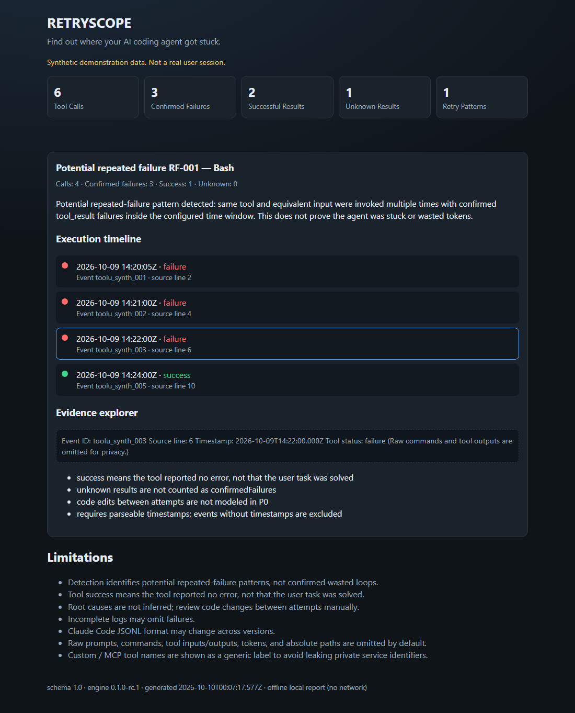

# RetryScope

**Find out where your AI coding agent got stuck.**

Local-first CLI that analyzes Claude Code session JSONL for evidence-linked repeated tool failures. No LLM API. No cloud upload. Offline HTML + JSON + Markdown reports.

> Status: **0.1.0-rc.1** on GitHub ([Releases](https://github.com/flower1201/retryscope/releases)). Demo data is **synthetic**. Detects *potential* repeated failures only — not token waste. **npm Registry: not published.**

## Demo (synthetic)

```bash
git clone https://github.com/flower1201/retryscope.git
cd retryscope
npm install
npm run demo
```

Then open `examples/out-demo/index.html` in a browser (`file://` works). You should see finding **RF-001** (Bash) with a clickable execution timeline.



```bash
node ./dist/cli/index.js analyze ./examples/synthetic-session.jsonl --out ./examples/out-demo
```

### Install from GitHub Pre-release (no npm Registry)

```bash
curl -fsSL -o retryscope-0.1.0-rc.1.tgz \
  https://github.com/flower1201/retryscope/releases/download/v0.1.0-rc.1/retryscope-0.1.0-rc.1.tgz
npm install ./retryscope-0.1.0-rc.1.tgz
npx retryscope --help
```

Release page: https://github.com/flower1201/retryscope/releases/tag/v0.1.0-rc.1  
Still offline. **npm Registry is not published.**

## Quick start (from source)

```bash
npm install
npm run build
node ./dist/cli/index.js --help
node ./dist/cli/index.js analyze /path/to/session.jsonl --out ./retryscope-report
```

Writes:

```text
retryscope-report/
├── index.html
├── findings.json
└── summary.md
```

## Supported log shape (Claude Code JSONL)

Best-effort subset (format may change across Claude Code versions):

- JSONL lines with optional `type`, `timestamp`, `message`
- `message.content[]` blocks:
  - `tool_use`: `{ id, name, input }`
  - `tool_result`: `{ tool_use_id, content?, is_error? }`
- Results link by **`tool_use_id` ↔ `id`** (never by array position alone)
- Missing result → `unknown` (never invented failure)

## Privacy

- Only reads the JSONL path you pass (no home-directory scan)
- Reports omit prompts, commands, raw tool inputs/outputs, and internal `inputGroupId`
- Custom / MCP tool names render as **Custom tool**
- Warning messages use fixed codes — not raw log lines
- Never upload private agent sessions for demos or issues

## Finding limitations

- Findings are **potential** repeated-failure patterns, not proof of wasted loops
- Tool `success` means the tool reported no error — not that the user task was solved
- Root causes are not inferred

## Feedback

Looking for Claude Code users to try the synthetic demo and say whether the report helps. Use [Discussions](https://github.com/flower1201/retryscope/discussions/1) or [Issues](https://github.com/flower1201/retryscope/issues) with **synthetic** reproductions only. See `SECURITY.md`.

## License

MIT
